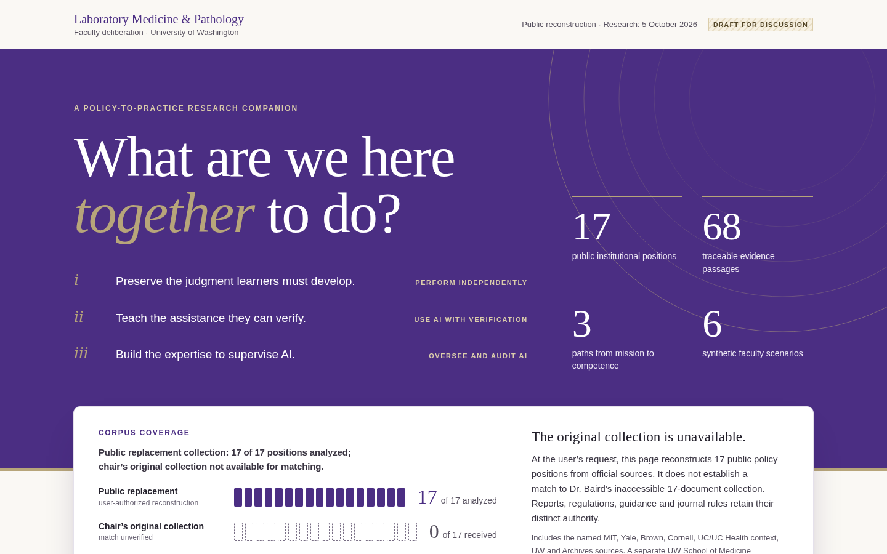

# DLMP AI Policy Explorer: Evidence Folio redesign

`DLMP_AI_Policy_Explorer.html` is the single-file faculty research tool for UW
Laboratory Medicine & Pathology, restyled with the **Evidence Folio** design
system. It still opens directly from disk, works offline, and keeps its embedded
evidence, page data and main script byte-for-byte unchanged.



## What's here

| Path | Contents |
| --- | --- |
| `DLMP_AI_Policy_Explorer.html` | The redesigned standalone page (the deliverable) |
| `source/DLMP_AI_Policy_Explorer.original.html` | The page as supplied, used as the transform's input |
| `design-system/DESIGN_SYSTEM.md` | Principles, tokens, components, accessibility notes |
| `design-system/tokens.json` | Design tokens with measured contrast pairs |
| `design-system/explorer.css` | The stylesheet inlined into the page |
| `design-system/explorer-enhancements.js` | Presentation-only script: section highlighting, active filters, print disclosures |
| `design-system/design-pass-checks.json` | Results of the browser checks for this pass, shown in the page's methods |
| `tools/apply_design.py` | Builds the page from the original (standard library only) |
| `tools/verify_design.cjs` | Browser checks: offline load, interactions, keyboard, contrast, overflow, print |
| `docs/screenshots/` | Reference renders from the verification run |

## Rebuild and verify

```sh
python3 tools/apply_design.py
NODE_PATH="$(npm root -g)" node tools/verify_design.cjs DLMP_AI_Policy_Explorer.html verification
```

The verification run on 6 October 2026 (headless Chromium 141, file opened from
disk, networking disabled) passed 30 of 30 checks, including the page's own
self-test (15 of 15), interactions, keyboard focus, text contrast with every
disclosure open, horizontal overflow from 320 to 1440 px, and print. Screen
readers, Safari, Firefox and physical devices were not tested.

## What changed in the page

- New stylesheet and system-font type stack; UW Purple and UW Gold kept exactly.
- Hero restated as three numbered aims tied to the three competency modes.
- A corpus coverage instrument (17 filled ticks for the public reconstruction, 17 dashed for the chair's unavailable collection) replaces the left-border notice; the notice text is unchanged.
- Numbered sticky navigation that marks the section in view; numbered section kickers with layer badges.
- Stance marks (shape-coded, never color-only) on every evidence link, a key above the matrix, and a passage-stance strip on each source card.
- Source cards as ledger rows with date rails; evidence passages with an Interpretation panel and conditions.
- Detector-guidance tension shown side by side with its two quotations; Brown's authority warning as a companion card.
- Competency proposals arranged in three lanes; equal-height scenario and global cards; ruled agenda sheet.
- Methods gains a design-pass note and two verification ledgers plus the renewal queue already in the page data; the footer moves outside `<main>`.
